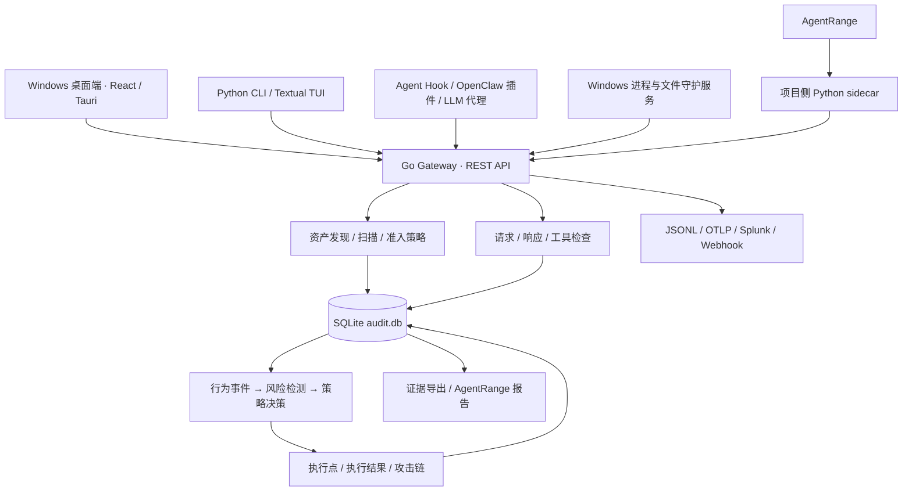

# TraceBastion

**面向本地 AI Agent 的资产治理、运行时防护与证据追踪平台。**

TraceBastion 将 Agent 发现、静态资源扫描、运行时风险检测、策略执行和攻击链调查整合到 Windows 与 Linux 桌面控制台，同时提供 Python CLI/TUI、Go 网关和 Agent 连接器。项目基于 DefenseClaw 演进，保留 `defenseclaw` 命令、Python 包名、网关可执行文件名及服务标识，以兼容既有配置和安装。

[桌面端说明](desktop/README.md) · [文档索引](docs/README.md) · [API 参考](docs/API.md) · [测试指南](docs/TESTING.md) · [许可证](LICENSE)

快速导航：[安装运行](#安装与快速开始) · [架构](#架构与数据流) · [配置与模式](#配置模式与防护边界) · [代码导航](#仓库导航) · [开发验证](#开发与验证) · [AgentRange](#agentrange-集成与评测)

## 项目能力

| 领域 | 已实现的能力 | 主要代码 |
| --- | --- | --- |
| Agent 发现与治理 | 结合进程、配置和特征目录识别 Agent；管理 Agent 类型、资源规则、扫描配置及治理策略 | `internal/inventory/`、`internal/gateway/`、`desktop/knowledge/` |
| 静态资源检测 | 发现配置、Skills、MCP、插件、提示词、凭据和环境资源；扫描、复扫、关联发现与准入决策 | `internal/watcher/`、`internal/scanner/`、`cli/defenseclaw/scanner/` |
| 运行时检查 | 通过 Hook、代理或插件检查请求、响应、工具参数和工具输出；支持本地规则、可选 LLM Judge 与 Cisco AI Defense | `internal/gateway/`、`internal/guardrail/`、`extensions/defenseclaw/` |
| 风险检测与响应 | 原子事件检测、会话内多事件关联、静态风险与运行行为关联；生成决策、执行记录与攻击链 | `internal/detection/`、`internal/audit/` |
| 异常检测配置 | 管理全局规则、Agent 类型规则与黑名单；配置风险区间、试算事件，并显式重放历史事件 | `desktop/src/runtime-detection/`、`internal/gateway/runtime_detection_settings_api.go` |
| Windows 守护 | 识别 Agent 子进程、匹配命令黑名单；读取文件访问审计、匹配敏感路径，按策略终止进程树 | `desktop/src-tauri/src/` |
| 审计与可观测性 | SQLite 审计、JSONL 日志、OTLP、Splunk HEC、Webhook，以及本地 Grafana/Loki/Tempo 等组件 | `internal/telemetry/`、`internal/gatewaylog/`、`bundles/` |
| AgentRange 验证 | 生成 Compose overlay、接入运行流量、验证静态资产和规则合同、汇总评测证据与 HTML 报告 | `integration/`、`bench/`、`dashboard/` |

CodeGuard 提供代码静态检查；Skills 和 MCP 扫描还会调用外部扫描器。原生 CodeGuard skill/rule/plugin 的安装是显式启用项，不能将扫描接口可用等同于 Agent 已安装对应扩展。

## 选择运行方式

| 需求 | 入口 | 条件 |
| --- | --- | --- |
| Windows 图形控制台 | NSIS 桌面安装包或桌面源码构建 | Windows 10/11 x64；WebView2 |
| Linux 图形控制台 | DEB 或 AppImage 安装包 | Ubuntu 22.04/24.04、Debian 12 x86_64；WebKitGTK 4.1 |
| 配置 Agent、扫描、终端界面 | Python CLI/TUI + Go Gateway | Windows、macOS 或 Linux；连接器能力依平台而异 |
| OpenClaw / ZeptoClaw 代理连接器 | CLI + Gateway；OpenClaw 另需插件 | macOS / Linux；当前 Windows 使用 Hook 路径，不支持这两个代理连接器 |
| AgentRange 场景验证 | 桌面“靶场控制”或 Compose overlay | Docker Compose 及原始靶场；回放另需 Python/uv |
| OpenShell 隔离 | CLI 沙箱命令与安装脚本 | Linux；属于可选沙箱路径 |
| 本地受控命令 | `defenseclaw sandbox status/exec` | Linux bubblewrap、macOS sandbox-exec、Windows AppContainer；后端不可用时拒绝执行 |

仓库注册了 Codex、Claude Code、Hermes、Cursor、Windsurf、Gemini CLI、Copilot、OpenHands、Antigravity、OpenCode、Omnigent、OpenClaw 和 ZeptoClaw 连接器。**发现某个 Agent 不代表已接入全部防护面**：可阻断事件、原生审批、资源写入及失败处理能力以连接器合同和实际安装版本为准。参见 [连接器源码](internal/gateway/connector/) 与 [Hook 合同](cli/defenseclaw/inventory/hook_contracts.json)。

## 安装与快速开始

以下源码命令均从本仓库根目录执行，单独标明工作目录的除外。克隆本仓库：

```bash
git clone https://github.com/CSTG-yf/AgentScan-Tool.git
cd AgentScan-Tool
```

### Windows 桌面端

Windows 安装包的发布入口为本仓库的 [GitHub Releases](https://github.com/CSTG-yf/AgentScan-Tool/releases)，可用版本及附件以发布页为准。安装器支持选择目标目录；机器级安装和守护服务管理需要管理员权限。

### Linux 桌面端

Linux 发布产物位于 `dist/linux/`，包括 Debian 安装包和 AppImage。Debian/systemd 环境可在桌面“服务管理”中通过 PolicyKit 安装系统级进程守护；AppImage 可独立运行 UI 与 Gateway，但系统级守护仍需管理员授权安装。

```bash
bash desktop/scripts/linux/build.sh
sudo apt install ./dist/linux/TraceBastion-Desktop-Setup-Linux-x86_64.deb
```

Linux 进程发现和子进程监控读取 `/proc`，执行策略前校验进程启动标识，避免 PID 复用误杀。普通未受控进程的文件审计无法透明替换一次 `read(2)` 的内容；`returnEmptyContent` 仅在受控 Agent 文件代理路径上保证，其他路径会明确上报能力降级。

Linux 的 FUSE + mount namespace 受控启动方法见 [Linux 发布版使用说明](desktop/src-tauri/README-Linux.md)。

| 源码构建工具 | 要求 |
| --- | --- |
| Node.js | 20.19+；仓库 Windows 工作流使用 22.12.0 |
| pnpm | `desktop/package.json` 固定为 10.33.0 |
| Rust | stable MSVC 工具链；另需 Visual Studio C++ Build Tools |
| Go | 1.26.4 或兼容的更高工具链，以 `go.mod` 为准 |
| WebView2 | 桌面 WebView 运行时 |

```powershell
# 安装依赖、构建 Go 网关、前端与 Tauri NSIS 安装包
.\desktop\scripts\build.ps1
```

输出：`dist/TraceBastion-Desktop-Setup-x64.exe`。构建脚本会检查网关产物和安装器的目录选择页。

开发时，在完成一次上述构建后启动桌面开发模式：

```powershell
cd desktop
pnpm dev
```

仅预览前端可在 `desktop/` 执行 `pnpm dev:web`；仅编译前端可在根目录执行：

```powershell
.\desktop\scripts\build.ps1 -WebOnly
```

桌面界面包含安全总览、Agent 治理、Agent 检测、静态资源、事件检测、攻击链、行为追踪、策略、告警、报告与靶场控制。进入后先确认网关状态，再配置扫描范围或 AgentRange 根目录；进程和文件守护需单独安装服务、启用规则并应用策略。详细说明见 [desktop/README.md](desktop/README.md)。

### Python CLI 与 Go Gateway

Python 包声明支持 3.10+，其中 MCP 扫描器依赖仅在 Python 3.11+ 安装；AgentRange 报告脚本也使用 Python 3.11+ 特性。若同时开发靶场回放，统一使用 Python 3.12。`uv.lock` 与 `pyproject.toml` 包含依赖锁定及覆盖约束，源码安装使用 `uv sync --locked`。

Windows PowerShell：

```powershell
uv sync --locked --python 3.12
go build -o .\defenseclaw-gateway.exe .\cmd\defenseclaw
$env:PATH = "$PWD;$PWD\.venv\Scripts;$env:PATH"

defenseclaw init --connector codex --profile observe --scanner-mode local
defenseclaw-gateway start
defenseclaw doctor
defenseclaw tui
```

将 `codex` 换成已安装、受当前平台支持的连接器名称。初始化会写入配置并接入所选 Agent；需要重载的 Agent 会在设置流程中给出提示。

macOS / Linux（需 Bash、GNU Make、uv 和 Go）：

```bash
make install
export PATH="$HOME/.local/bin:$PATH"

defenseclaw init --connector codex --profile observe --scanner-mode local
defenseclaw-gateway start
defenseclaw doctor
defenseclaw tui
```

`make install` 默认不安装 OpenClaw 插件。OpenClaw 用户还需 Node.js/npm，先执行 `make extensions`，再执行 `make install CONNECTOR=openclaw`，初始化时选择 `openclaw`。`make all` 会额外更新 PATH 并进入初始化流程，适用于需要一站式配置的环境。

`scripts/install.sh`、`scripts/install.ps1` 和部分历史安装文档仍指向上游 DefenseClaw 发布源；获取本仓库的桌面端及项目侧改动，应使用上面的本仓库源码或发布入口。

### 常用操作

```bash
defenseclaw status
defenseclaw config path
defenseclaw config validate
defenseclaw skill scan all
defenseclaw mcp list
defenseclaw plugin scan extensions/defenseclaw
defenseclaw guardrail status
defenseclaw sandbox status
```

运行单条非交互命令时，可使用 `defenseclaw sandbox exec --workspace <目录> -- <命令及参数>`。它会显示实际后端、按命令审批策略判断，并把启动与退出写入审计库；只对该命令及其子进程生效，不会自动隔离已由其他方式启动的 Agent。完整说明见 [沙箱指南](docs/SANDBOX.md)。

针对已接入 Agent 调整 Guardrail 模式：

```bash
defenseclaw setup guardrail --mode observe --restart
defenseclaw setup guardrail --mode action --restart
```

需要 LLM Judge 或扫描器模型分析时，通过 `defenseclaw setup llm` 配置。基础本地规则和 AgentRange 的确定性 `llm-stub` 不要求外部模型 API。

### 首次运行后检查

1. **网关可用**：CLI 用户执行 `defenseclaw doctor`、`defenseclaw status`；桌面用户在系统设置中检查网关状态。
2. **Agent 已接入**：确认 Agent 检测页出现实例，并核对连接器配置。目录发现只能证明安装痕迹，运行事件还需要 Hook、代理或插件接入。
3. **证据可追踪**：通过已接入 Agent 执行一次普通操作，在行为追踪中查看事件，再根据实际命中查看检测、决策及执行结果。普通操作没有风险检测是正常情况。

## 架构与数据流



- **桌面端**：React 19、TypeScript、Ant Design 与 ECharts 展示数据；Tauri 2/Rust 通过 IPC 调用网关、管理进程和靶场生命周期。浏览器预览不具备本机进程访问、服务管理或真实防护能力。
- **CLI/TUI**：Python Click 提供操作命令，Textual 提供终端界面，负责初始化、扫描器编排、配置、注册表与可观测性设置。
- **网关**：Go 负责 REST API、连接器、检查、资产与行为数据、检测和策略执行。OPA/Rego 承载部分策略；运行时检测与关联逻辑位于 `internal/detection/`。
- **Windows 服务**：`DefenseClawProcessGuard` 以 LocalSystem 运行。普通桌面界面通过固定提权入口安装服务、应用策略；服务记录 JSONL，并向网关上报行为事件。
- **证据**：行为事件存储在 Go 网关的 `audit.db` 中，检测、决策、响应动作和攻击链都有后端记录。应结合执行结果判断是否真正阻断，不能只看决策中的 `BLOCK`。

核心入口：[Python main](cli/defenseclaw/main.py)、[Go main](cmd/defenseclaw/main.go)、[网关 API](internal/gateway/api.go)、[Tauri IPC 注册](desktop/src-tauri/src/lib.rs)、[OpenClaw 插件](extensions/defenseclaw/src/index.ts)。

### 核心数据对象

| 对象 | 回答的问题 | 关联方式 |
| --- | --- | --- |
| Agent 类型 / 实例 | 使用哪类 Agent，具体是哪一个实例？ | 类型配置与实例 `agent_id` 分开管理 |
| 静态资源 / 发现项 | 哪个配置、Skill、MCP 或文件存在风险？ | 资源归属实例，发现项记录扫描结果 |
| 行为事件 | 实际发生了什么？ | 用 Agent、session、trace 关联上下文 |
| 风险检测 / 证据 | 哪些行为命中了哪些规则？ | 检测保存规则版本，并关联原始事件 |
| 策略决策 / 响应 | 应采取什么措施，实际执行结果如何？ | 决策与响应记录分开查询 |
| 攻击链 | 多个检测和行为如何组成调查线索？ | 持久化链、节点与证据关联 |
| 后台任务 | 扫描、重放或重建是否完成？ | 通过任务 ID 查询状态和结果 |

## 核心接口

桌面页面经 [bridge.ts](desktop/src/bridge.ts) 调用 [Rust commands](desktop/src-tauri/src/commands/)，再访问网关 REST API。下表列出当前路由入口；参数、响应字段和认证细节参见 [API 文档](docs/API.md) 及对应处理器。

| 业务 | 路由入口 | 后端实现 |
| --- | --- | --- |
| Agent 实例与治理配置 | `/api/v1/agents`、`/api/v1/agent-governance/` | [实例 API](internal/gateway/unified_runtime_api.go)、[治理 API](internal/gateway/agent_governance_api.go) |
| 静态资源、发现项和扫描历史 | `/api/v1/static-resources` | [静态资源 API](internal/gateway/static_resources_api.go) |
| 请求与工具检查 | `/api/v1/inspect/` 下的 `request`、`response`、`tool`、`tool-response` | [路由注册](internal/gateway/api.go) |
| 原始行为、会话与时间线 | `/api/v1/behavior-events`、`/api/v1/runtime-events`、`/api/v1/runtime-sessions` | [行为采集 API](internal/gateway/behavior_events_api.go)、[运行时 API](internal/gateway/runtime_events.go) |
| 风险检测、决策与执行结果 | `/api/v1/runtime-detections`、`/api/v1/runtime-decisions`、`/api/v1/enforcements` | [检测与决策 API](internal/gateway/runtime_events.go)、[执行 API](internal/gateway/unified_runtime_api.go) |
| 异常检测配置与事件试算 | `/api/v1/runtime-detection-settings` | [配置 API](internal/gateway/runtime_detection_settings_api.go)、[配置与匹配逻辑](internal/detection/configuration.go) |
| 攻击链 | `/api/v1/attack-chains` | [攻击链与事件接口说明](docs/reference/ATTACK_EVENTS_AND_CHAINS_API.md) |
| 后台任务与数据变更游标 | `/api/v1/jobs`、`/api/v1/changes` | [任务 API](internal/gateway/jobs_api.go)、[变更 API](internal/gateway/changes_api.go) |
| 扫描计划与页面刷新 | `/api/v1/scan-schedules`、`/api/v1/page-refresh-settings` | [调度 API](internal/gateway/scan_schedules_api.go)、[持久化模型](internal/audit/scan_schedules.go) |

原始行为事件、风险检测、策略决策和执行结果是不同层次的数据。调查时沿 Agent、session/trace 和证据关联查阅，判断阻断是否成功需要查看执行记录。扫描、历史事件重放和攻击链重建通过任务接口显式触发；规范任务类型为 `agent_discovery`、`static_assets`、`runtime_detections`、`attack_chains`、`behavior_trace` 和 `environment`，旧 `kind` 名称继续兼容。

异常检测设置和“扫描与刷新策略”都位于桌面“Agent 治理中心”。Agent 类型可继承全局规则、添加专属规则与黑名单，并选择全局或自定义风险策略。配置保存后用于后续检测，已有检测记录保留原规则版本；需要重新评估历史行为时，显式创建 `runtime_detections` 重放任务，可通过 `scope.agent_type_id` 限定类型。事件试算返回匹配结果与风险决策，不执行阻断。扫描策略创建后端 Job 并产生新数据；页面刷新策略只读取数据库，二者分别持久化。

## 配置、模式与防护边界

| 配置或数据 | 位置 / 含义 |
| --- | --- |
| CLI 数据目录 | 默认 `~/.defenseclaw/`；可通过 `DEFENSECLAW_HOME` 覆盖 |
| 配置文件 | 数据目录下的 `config.yaml`；`DEFENSECLAW_CONFIG` 可单独指定文件 |
| 令牌与密钥 | 数据目录下的 `.env`；网关令牌通常使用 `DEFENSECLAW_GATEWAY_TOKEN` |
| 桌面网关数据 | Windows 通常为 `%APPDATA%\dev.defenseclaw.desktop\defenseclaw-home\` |
| Windows 服务数据 | `%ProgramData%\DefenseClaw\` 下的策略、网关客户端配置和服务审计 |
| 网关 REST API | 默认端口 `18970`；监听地址由 `gateway.api_bind` 等配置决定 |
| LLM Guardrail 代理 | 默认端口 `4000`；与 REST API、OpenClaw WebSocket 连接分开 |
| 策略与规则源文件 | `policies/`、`internal/guardrail/defaults/`；初始化后可在数据目录定制 |

桌面端与 CLI 默认数据目录不同；两者默认 API 端口相同。选择一种网关启动方式，或为不同实例配置独立端口，并让客户端指向对应实例。

模式分属不同控制面，调整时应核对实际生效项：

| 控制面 | 模式 | 作用 |
| --- | --- | --- |
| Guardrail | `observe` / `action` | 记录检查结果，或按规则执行阻断 |
| 运行时检测决策 | `observe` / `action` | 决策引擎单独持久化模式；控制关联检测后的响应执行 |
| Windows 守护服务 | `observe` / `enforce` | 记录命中，或在校验进程身份后终止 Agent 进程树 |
| AgentRange | `baseline` / `observe` / `action` | 原始靶场，或经适配 sidecar 接入检查；适配计划的模式字段不替代网关配置 |

- Hook 在 Agent 提供对应执行前事件时可以提前拒绝操作；Windows 进程守护属于进程启动后的补充控制。
- 文件守护依赖已配置路径的 Windows 审计策略/SACL，并处理 Security 4663、4660 等事件。访问已经发生后才可能终止后续行为，**不能保证阻止首次读取或撤销已发生的写入**。
- 当前 Trace 客户端将行为事件尽力上报给网关；网关不可用时，上报不阻塞进程/文件守护执行，也没有本地 Trace 队列保证补传。服务 JSONL 与后端行为记录应分别检查。
- 各接入路径的异常处理不同。例如 AgentRange sidecar 默认检查超时为 250 ms、失败放行；OpenClaw 工具检查默认失败阻断。应以各自配置为准，不能把 `observe/action` 当成统一的故障处理开关。

更多配置见 [配置文件指南](docs/CONFIG_FILES.md)、[环境变量](docs/ENV-VARS.md) 和 [Guardrail](docs/GUARDRAIL.md)。

### 常见问题定位

| 现象 | 优先检查 |
| --- | --- |
| 桌面与 CLI 显示的数据不同 | 两者是否连接同一个网关，是否使用同一数据目录 |
| 网关启动失败或端口被占用 | 是否已有桌面或 CLI 网关占用 `18970`，配置中的端口是否一致 |
| 浏览器预览没有真实数据或操作不可用 | 是否通过 Tauri 桌面启动；`pnpm dev:web` 仅启动前端 |
| 发现了 Agent，但没有行为事件 | 对应 Hook、代理或插件是否接入，Agent 是否已按提示重载 |
| 出现高风险或 BLOCK，但未阻断 | 决策模式、执行点是否可用，以及实际响应状态 |
| 修改规则后历史记录没有变化 | 保存仅作用于后续检测；历史重新评估需显式事件重放 |

## 仓库导航

| 目录 | 职责 |
| --- | --- |
| `desktop/` | Windows/Linux 桌面 UI、Tauri 宿主、平台守护服务、合同与构建脚本 |
| `cli/defenseclaw/` | Python CLI、Textual TUI、扫描器、注册表与靶场适配 |
| `cmd/defenseclaw/` | Go 网关入口 |
| `internal/gateway/`、`internal/inventory/` | API、代理、连接器、任务、治理与 Agent 发现 |
| `internal/scanner/`、`internal/watcher/` | 扫描执行、变更监听、复扫及准入 |
| `internal/detection/`、`internal/audit/` | 风险检测、响应、攻击链与 SQLite 存储 |
| `internal/guardrail/`、`internal/policy/` | 运行时规则、关联器与 OPA 策略 |
| `internal/enforce/`、`internal/firewall/`、`internal/sandbox/` | 准入执行、网络与沙箱控制 |
| `internal/telemetry/`、`internal/gatewaylog/` | OpenTelemetry 与结构化日志 |
| `extensions/defenseclaw/`、`plugins/` | OpenClaw TypeScript 插件、Go 扫描器扩展接口及示例 |
| `policies/`、`schemas/` | YAML/Rego 策略、扫描配置、规则包与跨组件 Schema |
| `bundles/` | 本地可观测性、Splunk、注册表及模型目录资源 |
| `integration/`、`bench/`、`dashboard/` | AgentRange 合同、证据处理、评测汇总与展示 |
| `task/AgentRange-player/`、`task/agentrange-adapter/` | 原始验证靶场、项目侧生成的 overlay 与适配计划 |
| `test/`、`cli/tests/` | 测试、语料与夹具；Go 包内另有 `*_test.go` |
| `scripts/`、`packaging/` | 安装、构建、校验与系统服务打包 |
| `docs/`、`docs-site/` | 操作/设计参考文档、Next.js/Fumadocs 文档站与策略编辑器 |

阅读代码时，建议先从一条完整业务链入手：

1. **页面到存储**：`desktop/src/pages/` → `desktop/src/bridge.ts` → `desktop/src-tauri/src/commands/` → `internal/gateway/` → `internal/audit/`。
2. **运行时检测**：`internal/gateway/runtime_events.go` → `internal/detection/engine.go` → `rules.go` 与规则实现 → `policy.go` → 审计库中的检测、决策、响应与攻击链。
3. **资源扫描**：`internal/inventory/` 发现身份与资源，`internal/watcher/` 编排扫描及准入，`internal/scanner/` 与 Python 扫描器执行检测。
4. **Agent 接入与评测**：`cli/defenseclaw/commands/` 配置接入，`internal/gateway/connector/` 与 `extensions/` 处理运行流量，`integration/`、`bench/` 和 `dashboard/` 处理评测证据。

## 开发与验证

根目录 Makefile 的构建和测试命令主要面向 Bash 环境；Windows 桌面使用 PowerShell 构建脚本。各组件有独立构建入口，`make build` 不包含桌面端或文档站。

| 检查 | 命令与范围 |
| --- | --- |
| CLI、网关、插件构建 | `make build` |
| Python 与主要 Go 测试 | `make test`；Go 部分仅覆盖 `internal/gateway` 与 `test/...` |
| 全部 Go 包 | `make go-test-cov`（含 race 和覆盖率） |
| OpenClaw 插件 | `make ts-test` |
| Rego 策略 | `make rego-test`（需 OPA CLI） |
| 数据合同一致性 | `make check`；审计动作、错误码、Schema、仪表盘、供应商/模型目录等 |
| Python / Go 静态检查 | `make lint` |
| 桌面 TypeScript | 在 `desktop/` 执行 `pnpm check` |
| Rust 宿主测试 | `cargo test --locked --manifest-path desktop/src-tauri/Cargo.toml` |
| 文档站 | 在 `docs-site/` 安装依赖后执行 `npm run validate-links`、`npm run validate-snippets`、`npm run build` |

Windows CLI 的安装文档检查可直接运行：

```powershell
.\.venv\Scripts\python.exe -m pytest cli/tests/test_install_docs_static.py -q
```

全量 CLI 文档命令检查位于 `cli/tests/test_docs_cli_commands.py`，使用实际 Click 命令树验证示例。它也覆盖 macOS/Linux 的 OpenClaw 示例；当前 Windows 命令树不接受该连接器，因此这项跨平台文档检查应在 macOS/Linux 环境执行。

桌面端另有 [进程守护](desktop/scripts/test-process-guard.ps1)、[文件守护](desktop/scripts/test-file-guard.ps1) 和 [安装器生命周期](desktop/scripts/test-installer.ps1) 验收脚本，需要在合适的 Windows 管理员测试环境中执行。仓库的 [Windows 工作流](.github/workflows/desktop-windows.yml) 定义了桌面构建、部分验收及安装包发布步骤；其他组件的检查入口以 Makefile 和包脚本为准。

## AgentRange 集成与评测

项目提供独立的 AgentRange 验证链路：项目侧适配器生成 Compose overlay，sidecar 检查运行流量，`integration/` 导出静态与运行时证据，`bench/` 汇总各模式结果，`dashboard/` 生成 HTML 报告。桌面“靶场控制”也可管理靶场与回放。

需要 Docker Compose、原始靶场和 CLI/Gateway 环境。完整的网络配置、启动命令、回放前提、报告生成和停止步骤见 [AgentRange 操作指南](docs/AGENTRANGE.md)。

| 入口或产物 | 用途 |
| --- | --- |
| `task/AgentRange-player/` | 原始靶场与场景手册 |
| `task/agentrange-adapter/` | 项目侧 overlay 与适配计划 |
| `integration/reports/` | 静态扫描、规则合同、运行时事件、攻击链及综合报告 |
| `bench/results/` | baseline / observe / action 结果与汇总 |
| `dashboard/index.html` | 生成后的静态评审页面 |

`benchmark.py summarize` 只汇总已有数据，不会执行三种模式的回放。应核对缺失模式、实际事件和执行结果；静态合同命中率不能替代运行时检出率。项目侧报告链与 Go 后端实时攻击链的构建逻辑也不同，详见 [数据合同](integration/agentrange_contracts/README.md)。

## 延伸文档

| 主题 | 文档 |
| --- | --- |
| 操作入门 | [CLI 参考](docs/CLI.md)、[Quick Start](docs/QUICKSTART.md)、[TUI](docs-site/content/docs/tui.mdx) |
| 桌面与权限 | [桌面说明](desktop/README.md)、[架构边界](desktop/docs/ARCHITECTURE.md)、[Agent 知识库](desktop/knowledge/README.md) |
| 后端与接口 | [架构](docs/ARCHITECTURE.md)、[API](docs/API.md)、[攻击事件与攻击链 API](docs/reference/ATTACK_EVENTS_AND_CHAINS_API.md) |
| 检查与策略 | [Guardrail](docs/GUARDRAIL.md)、[规则包](docs/GUARDRAIL_RULE_PACKS.md)、[注册表](docs/REGISTRIES.md)、[自定义扫描器](docs/PLUGINS.md) |
| 隔离与观测 | [OpenShell](docs/SANDBOX.md)、[可观测性](docs/OBSERVABILITY.md)、[本地观测栈](bundles/local_observability_stack/README.md)、[Splunk](docs/SPLUNK_APP.md) |
| 靶场验证 | [AgentRange 操作指南](docs/AGENTRANGE.md)、[需求追踪](integration/requirements.yaml) |
| 开发资料 | [测试](docs/TESTING.md)、[Schema 归属](schemas/README.md)、[文档站](docs-site/README.md) |

部分深入文档沿用 DefenseClaw 名称或历史架构描述；涉及当前版本、路径、构建命令及功能边界时，以对应组件的代码、清单和本 README 为准。

## 贡献与许可

贡献流程见 [CONTRIBUTING.md](CONTRIBUTING.md) 和 [开发指南](docs/CONTRIBUTING.md)，安全问题披露流程见 [SECURITY.md](SECURITY.md)。

项目采用 **Apache-2.0**，详见 [LICENSE](LICENSE) 与 [NOTICE](NOTICE)。保留上游版权声明：Copyright 2026 Cisco Systems, Inc. and its affiliates.
