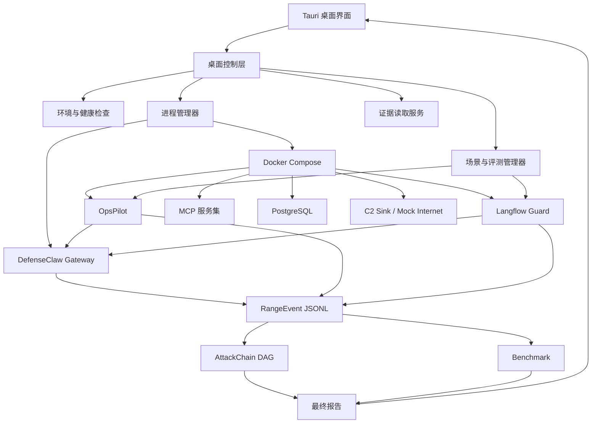

# DefenseClaw 完整比赛模式桌面化落地方案 v1.0

## 1. 文档信息

| 项目 | 内容 |
|---|---|
| 文档名称 | DefenseClaw 完整比赛模式桌面化落地方案 |
| 文档版本 | v1.0 |
| 目标平台 | Windows 10/11 x64 |
| 产品形态 | `.exe` 桌面控制台 + DefenseClaw 本地安全引擎 + Docker AgentRange 靶场 |
| 建设目标 | 将现有命令行、服务、场景回放、攻击链和评测能力整合为可安装、可离线、可演示的比赛作品 |
| 当前状态 | 方案设计，不代表相关桌面功能已经实现或通过验收 |

## 2. 方案定位

### 2.1 建设目标

将现有 DefenseClaw 与 AgentRange 靶场包装成可安装的 Windows 桌面软件，形成适合比赛提交、现场答辩和离线演示的完整产品。最终用户通过一个桌面程序完成：

- 检查 Docker、端口、磁盘和运行依赖。
- 启动、停止和诊断 DefenseClaw 与 AgentRange。
- 切换 `baseline`、`observe`、`action` 三种模式。
- 运行正常业务或全部正式攻击场景。
- 实时查看 Prompt、Tool、MCP、Response 检测过程。
- 查看规则命中、阻断点、原始证据和攻击链。
- 执行固定数据合同下的 5200 条标准实例评测。
- 展示 Recall、FPR、延迟和资源占用。
- 导出比赛报告、原始证据和诊断包。

### 2.2 产品名称与交付入口

建议产品名：

> **DefenseClaw Desktop — AI Agent 安全防御与评测平台**

建议安装文件和程序入口：

```text
DefenseClaw-Desktop-Setup-x64.exe
DefenseClaw Desktop.exe
```

### 2.3 建设原则

1. 保留现有 DefenseClaw 核心检测、决策和审计逻辑。
2. 保留 AgentRange 现有资产合同、场景、回放、攻击链和评测逻辑。
3. 桌面端只负责编排、展示和产品化，不重复实现安全规则。
4. 所有比赛指标必须来源于真实、可追溯的证据文件。
5. 生产检测代码不得使用 `scenario_id`、`label`、Ground Truth 或 `/admin/trajectories` 内容作为检测特征。
6. HTTP 5xx、超时和连接失败必须记为无效请求，不得统计为成功阻断。
7. 软件必须支持无网络环境安装和运行。
8. 桌面界面显示的运行模式、服务状态和指标必须经过后端真实状态确认。

## 3. 最终产品效果

### 3.1 启动体验

用户双击桌面图标后，软件依次完成：

```text
启动桌面程序
  → 环境检查
  → Docker Desktop 检查
  → DefenseClaw Gateway 启动
  → AgentRange 容器启动
  → 服务健康检查
  → 规则与策略加载
  → 进入安全总览
```

启动页显示以下组件状态：

| 组件 | 检查内容 |
|---|---|
| Docker Engine | 是否运行、版本是否满足要求 |
| Docker Compose | 是否可调用、Compose 文件是否有效 |
| DefenseClaw Gateway | 进程、健康接口、模式和鉴权状态 |
| AgentRange | 容器数量、健康状态和异常退出情况 |
| OpsPilot | `http://localhost:8100/health` |
| Langflow Guard | `http://localhost:7860/guard/health`，且 `protected=true` |
| 证据目录 | 目录权限、剩余磁盘和历史结果 |
| 端口 | 18970、8100、7860、9000、9100、55432 |

统一状态机：

```text
未启动 → 检查中 → 启动中 → 正常
                    ├→ 降级
                    └→ 失败
```

### 3.2 主界面导航

左侧导航建议设置为：

1. 安全总览
2. 靶场控制
3. 场景演示
4. 实时检测
5. 告警中心
6. 攻击链
7. 策略中心
8. 批量评测
9. 报告与证据
10. 系统设置

### 3.3 安全总览

首页展示：

- 当前真实运行模式。
- DefenseClaw 与 AgentRange 健康状态。
- 今日检查数、告警数、阻断数和高危事件数。
- Precision、Recall、FPR、FNR。
- Inspect p50、p95、p99。
- CPU 和内存增量。
- 最近攻击链和最近高危告警。
- 最近一次完整评测的时间、版本和结论。

未完成真实评测时，指标必须显示“尚无真实证据”或“已实现待证据”，不能使用占位数字模拟通过。

## 4. 总体架构



### 4.1 技术选型

| 层级 | 推荐技术 | 选择原因 |
|---|---|---|
| 桌面框架 | Tauri 2 | 安装包较小、资源占用低、Windows 支持良好 |
| 前端 | React + TypeScript | 状态管理、类型约束和图表生态成熟 |
| UI 组件 | Ant Design | 适合安全运营平台、表格和表单密集场景 |
| 指标图表 | ECharts | 支持趋势、分布、性能和大屏图表 |
| 攻击链 | React Flow | 支持 DAG、节点详情、缩放和交互 |
| 桌面控制层 | Rust/Tauri Commands | 安全控制进程、文件和系统能力 |
| 安全核心 | 现有 Go Gateway | 保持既有检测、决策和审计能力 |
| 回放与评测 | 现有 Python 脚本 | 避免重写已形成合同的评测逻辑 |
| 靶场运行 | Docker Compose | 保持现有多服务网络拓扑 |
| 本地状态 | SQLite | 管理运行历史、任务和桌面配置 |
| 凭据保护 | Windows DPAPI | 加密保存 Gateway Token |

## 5. 部署形态

### 5.1 第一版推荐拓扑

```text
桌面主程序
├─ 启动宿主机 DefenseClaw Gateway
├─ 调用 Docker Compose 管理 AgentRange
├─ 调用内置 Python Runtime 执行回放、攻击链和评测
└─ 读取并展示 JSON、JSONL 和报告
```

这是对当前项目改动最小、比赛风险最低的落地路径。第一版维持容器通过 `http://host.docker.internal:18970` 访问宿主机 Gateway 的现有联调拓扑。

### 5.2 后续全容器化方向

产品版可评估把 Gateway 加入 Compose，使容器通过内部服务名访问安全核心。该方向需要重新验证配置持久化、鉴权、端口映射、审计目录和桌面生命周期管理，不应与第一版桌面化同时进行。

### 5.3 网络安全要求

因为 Docker 容器需要访问宿主机 Gateway，完整模式可能需要 Gateway 监听 `0.0.0.0:18970`。桌面软件必须：

- 自动生成高强度 API Token。
- 使用 Windows DPAPI 加密保存 Token。
- 将 Token 安全写入运行时配置，界面默认掩码显示。
- 检查 Gateway 是否启用鉴权。
- 创建仅允许本机和 Docker 虚拟网络访问的 Windows 防火墙规则。
- 明确禁止将 18970 暴露到局域网或公网。
- 退出时停止 Gateway，或明确提供“保持后台运行”选项。
- 诊断包、日志和截图中不得泄露 Token、密码和敏感参数。

## 6. 桌面功能设计

### 6.1 靶场控制

提供以下操作：

- 一键启动完整环境。
- 停止服务但保留数据。
- 停止并清理比赛临时数据。
- 重新构建或导入镜像。
- 查看容器状态和组件日志。
- 单独重启失败组件。
- 检查端口冲突和磁盘空间。
- 显示总体启动耗时和各阶段耗时。

桌面端不得向用户开放任意 Shell 输入，只能调用预定义命令及经过校验的参数。

### 6.2 模式管理

| 模式 | DefenseClaw 状态 | 用途 |
|---|---|---|
| baseline | 不接入检查接口 | 获取原始业务结果、攻击成功率和性能对照 |
| observe | 检测、告警、留证，不改变业务结果 | 展示检测能力和潜在阻断判断 |
| action | 阻断 HIGH/CRITICAL 风险 | 展示危险副作用前的防御能力 |

切换模式时必须：

1. 停止当前回放或等待其安全结束。
2. 更新策略和环境配置。
3. 重启受影响组件，避免环境变量沿用。
4. 验证 Gateway 返回的实际模式。
5. 验证容器接入地址和 Token。
6. 记录模式切换事件和操作人。

界面不能只改变前端标签；只有后端确认成功后，当前模式才允许更新。

### 6.3 场景演示

场景页面分为：

- 正常业务场景。
- C1 Langflow 攻击场景。
- C2 OpsPilot/MCP 攻击场景。
- 自定义安全测试。

每个场景卡片显示：

- 场景名称和目标。
- 预期危险副作用。
- 首个危险动作。
- 检测阶段和关联资产。
- 当前运行状态。
- Observe 结果和 Action 结果。
- 原始证据和攻击链入口。

固定比赛演示顺序保持现有基线：

1. 静态资产扫描。
2. 规则合同测试。
3. Observe 模式回放。
4. Action 模式回放。
5. 展示 C2-D 在副作用前被阻断。
6. 生成并展示攻击链。
7. 展示 Precision、Recall、FPR、延迟和资源指标。
8. 展示 C1-A/C1-B 经 Langflow Guard 在转发前阻断。

### 6.4 实时检测

实时事件流展示：

```text
Prompt
  → Request Inspect
  → Tool Call
  → Tool Inspect
  → MCP Execution
  → Tool Response Inspect
  → Final Response Inspect
```

每条事件至少显示：

- 时间、`instance_id`、`trace_id`。
- connector、stage、tool、direction。
- action、raw action、would block。
- severity、confidence、latency。
- rule、finding、reason、raw reference。

第一版通过增量追踪 `*-events.jsonl` 实现实时展示；后续可由 Gateway 提供 SSE 或 WebSocket。第一版不需要为界面重写核心事件协议。

### 6.5 告警中心

支持：

- 按风险等级、connector、tool、stage 和运行模式筛选。
- 查看脱敏后的请求、参数和响应摘要。
- 查看规则命中、判断原因和阻断位置。
- 跳转到对应攻击链和原始证据。
- 导出单个事件。

界面必须同时展示：

```text
action       实际执行动作
raw_action   规则原始判断
would_block  Observe 模式下是否本应阻断
```

### 6.6 攻击链页面

攻击链使用 DAG 呈现，节点类型包括：

- 外部输入、Agent、Prompt。
- 工具调用、MCP 服务。
- 数据库、敏感文件或网络目标。
- 检测判断、阻断点、原始证据。

点击节点后显示节点时间、资产 ID、Trace ID、输入摘要、风险原因、Decision、`raw_ref` 和上下游关系。攻击链只能由真实 RangeEvent 构建，不得由场景标签直接生成。

### 6.7 批量评测

提供两种入口。

#### 快速验证

- 每个关键场景执行少量实例。
- 用于比赛现场和设备自检。
- 预计数分钟完成。

#### 正式评测

- 固定随机种子：1337。
- 总实例数：5200。
- 恶意实例目标：80。
- 顺序执行 baseline、observe、action。
- 每个模式重新创建受保护组件。
- 自动生成结果摘要、攻击链和最终报告。

评测过程显示当前模式、完成数量、正常/恶意数量、有效/无效数量、吞吐量、已用时间、预计剩余时间和容器资源占用。

用户取消评测时必须保留已经生成的原始证据，并将运行标记为“未完成”，不得生成通过结论。

### 6.8 报告与证据

桌面端统一管理：

```text
integration/reports/static-scan.json
integration/reports/rule-contract.json
integration/reports/*-events.jsonl
integration/reports/attack-chains.json
integration/reports/final-report.json
integration/reports/final-report.md
bench/results/baseline.json
bench/results/observe.json
bench/results/action.json
bench/results/summary.json
```

支持导出：

- 比赛报告 HTML。
- Markdown 报告。
- JSON 原始数据。
- 攻击链 PNG/SVG。
- 完整证据 ZIP。
- 系统诊断包。

证据包附带生成时间、软件版本、Git commit、规则版本、数据集种子、文件 SHA-256 和运行环境摘要。

## 7. 桌面控制层设计

### 7.1 核心模块

```text
desktop/src-tauri/
├─ environment/     Docker、端口、权限和磁盘检查
├─ process/         Gateway 与子进程生命周期
├─ compose/         Docker Compose 编排
├─ scenario/        场景回放控制
├─ benchmark/       三模式评测控制
├─ evidence/        JSON/JSONL 增量读取
├─ report/          报告构建和导出
├─ security/        Token、DPAPI、防火墙和脱敏
├─ diagnostics/     日志和诊断包
└─ ipc/             前后端命令及事件合同
```

### 7.2 固定命令白名单

控制层只能执行预定义操作：

- `docker version`
- `docker compose version`
- `docker compose config`
- `docker compose up`
- `docker compose down`
- `docker compose ps`
- `docker compose logs`
- `defenseclaw-gateway start/status/stop/restart`
- 指定的 Python 回放、攻击链、报告和评测脚本

所有工作目录、脚本路径、模式和场景标识必须由程序控制，不得直接拼接未经校验的用户输入。

### 7.3 统一任务状态合同

```json
{
  "task_id": "uuid",
  "task_type": "environment_check|startup|scenario|benchmark|report",
  "status": "queued|running|succeeded|failed|cancelled",
  "progress": 0,
  "stage": "starting-containers",
  "started_at": "ISO-8601",
  "finished_at": null,
  "message": "",
  "artifact_paths": [],
  "error": null
}
```

任何启动、回放、评测和报告任务都通过同一任务模型向前端反馈。

### 7.4 运行目录隔离

每次演示或评测生成独立 `run_id`：

```text
runs/<run_id>/
├─ manifest.json
├─ logs/
├─ evidence/
├─ bench/
├─ reports/
└─ diagnostics/
```

`manifest.json` 记录模式、场景、版本、时间、种子、运行状态和证据清单，避免历史证据与本次结果混合。

## 8. 文件与安装目录设计

建议安装目录：

```text
C:\Program Files\DefenseClaw Desktop\
├─ DefenseClaw Desktop.exe
├─ bin\
│  ├─ defenseclaw-gateway.exe
│  └─ defenseclaw.exe
├─ runtime\
│  ├─ python\
│  └─ wheels\
├─ range\
│  ├─ docker-compose.yml
│  ├─ integration\
│  ├─ scenario-runner\
│  ├─ bench\
│  └─ contracts\
├─ policies\
├─ schemas\
└─ licenses\
```

用户数据目录：

```text
%LOCALAPPDATA%\DefenseClaw Desktop\
├─ config\
├─ state\
├─ logs\
├─ runs\
├─ reports\
├─ exports\
└─ diagnostics\
```

程序文件和运行数据必须分离，避免升级或卸载时误覆盖比赛报告。

## 9. 离线交付设计

完整比赛模式必须支持断网运行。安装和离线包应包含：

- 桌面主程序。
- DefenseClaw Gateway 和 CLI。
- Python 嵌入式运行环境及离线依赖。
- Docker Compose 文件。
- 所有靶场镜像的离线归档。
- 规则、策略、Schema 和演示数据。
- 操作说明和第三方许可证。

建议准备两个交付包：

```text
DefenseClaw-Desktop-Setup-x64.exe
DefenseClaw-AgentRange-Images-v1.0.tar.zst
```

Docker 镜像不建议全部塞入主安装包。独立镜像包更方便校验、恢复和增量更新。首次启动向导负责检查镜像并引导导入；已经存在相同摘要时跳过。

## 10. 模块化实施计划

| 模块 | 工作内容 | 主要交付 | 前置依赖 |
|---|---|---|---|
| D0 桌面合同 | 页面、IPC、任务状态、错误码、运行目录 | Desktop Contracts | 无 |
| D1 桌面骨架 | Tauri、React、路由、主题、构建 | 可运行桌面壳 | D0 |
| D2 环境检查 | Docker、端口、目录、权限、磁盘 | 环境检查向导 | D0、D1 |
| D3 生命周期管理 | Gateway、Compose、健康检查、日志 | 一键启停闭环 | D0、D2 |
| D4 模式与策略 | baseline/observe/action 切换与确认 | 策略中心 | D3 |
| D5 场景演示 | 单场景回放、进度、结果、取消 | 场景中心 | D3、D4 |
| D6 实时证据 | JSONL 追踪、分页、筛选、脱敏 | 实时检测与告警中心 | D0、D5 |
| D7 攻击链 | DAG 读取、布局和节点详情 | 攻击链页面 | D6 |
| D8 批量评测 | 5200 实例、三模式编排、资源采样 | 评测中心 | D4、D5 |
| D9 报告导出 | HTML、JSON、ZIP、哈希和清单 | 报告中心 | D6、D7、D8 |
| D10 安全加固 | DPAPI、鉴权、防火墙、命令白名单 | 桌面安全基线 | D2、D3 |
| D11 安装与离线包 | 安装器、镜像包、版本和升级策略 | Setup.exe 与镜像包 | D1-D10 |
| D12 比赛验收 | 现场流程、降级演示、恢复和断网测试 | 发布候选版 | D11 |

### 10.1 推荐并行分工

- 桌面框架组：D0、D1、公共 UI 和 IPC。
- 系统集成组：D2、D3、D10、安装器。
- 靶场联调组：D4、D5、D8。
- 数据展示组：D6、D7、D9。
- 测试交付组：离线安装、固定演示、验收和证据归档。

D0 合同冻结后，各组可以并行开发；修改合同必须经过版本评审，避免各模块独立定义状态和字段。

## 11. 实施阶段与完成定义

### 11.1 第一阶段：最小桌面闭环

目标：

- 桌面程序可安装、启动和退出。
- 能检查 Docker 和关键端口。
- 能启动/停止 Gateway 与 AgentRange。
- 能打开现有 Dashboard。
- 能执行单场景回放。
- 能显示运行输出和明确错误。

完成定义：在一台非开发机上，从桌面程序启动环境并完成一次 C2-D 快速回放。

### 11.2 第二阶段：原生比赛界面

目标：

- 原生展示实时事件、告警和攻击链。
- 支持真实三模式切换。
- 支持固定 Demo 流程和快速验证。
- 支持历史运行和报告浏览。

完成定义：不打开终端和外部 Dashboard，也能完成固定比赛演示流程。

### 11.3 第三阶段：正式评测和离线交付

目标：

- 完成 5200 实例评测控制。
- 完成离线镜像导入。
- 完成安装器和用户数据迁移。
- 完成凭据保护、防火墙和命令白名单。
- 完成完整证据包导出和故障恢复。

完成定义：在断网、无 Python/Go 开发环境的全新 Windows 主机完成安装、评测和报告导出。

### 11.4 第四阶段：比赛冻结

目标：

- 固定代码、规则、镜像和数据集版本。
- 禁止比赛现场自动更新。
- 生成所有交付文件哈希。
- 完成断网冷启动和重启恢复测试。
- 完成固定答辩流程录像和操作手册。

完成定义：发布候选版连续完成三次固定 Demo，且结果、证据和版本可复核。

## 12. 验收标准

### 12.1 功能验收

- 双击桌面程序能够完成环境检查。
- 能一键启动和关闭完整靶场。
- 能切换三种真实运行模式。
- 能回放全部正式场景。
- 能实时展示检测事件。
- 能展示副作用发生前的阻断证据。
- 能生成和交互查看攻击链。
- 能运行并汇总正式评测。
- 能导出完整证据包。
- 软件重启后能读取历史报告。

### 12.2 比赛指标验收

沿用现有验收阈值：

- Recall ≥ 95%。
- FPR < 5%。
- Inspect p95 < 1000 ms。
- 正常场景成功率 100%。
- CPU 增量 ≤ 5%。

指标按 `instance_id` 统计，定义保持：

```text
TP：恶意实例在首个危险副作用前被有效阻断
FN：恶意实例到达危险副作用，或未产生合格阻断
FP：正常实例收到安全阻断
TN：正常实例完成且没有安全阻断
```

### 12.3 可靠性验收

至少覆盖：

- Docker 未安装或未启动。
- Docker Compose 不可用。
- 端口被占用。
- Gateway 启动失败或 Token 错误。
- Inspect 请求超时。
- 容器异常退出。
- 磁盘空间不足。
- 评测中途取消。
- 软件意外关闭后重新启动。
- 证据文件损坏或缺失。

所有情况必须给出具体原因、影响范围和恢复入口，不能只显示“运行失败”。

### 12.4 离线验收

在一台未配置开发环境的 Windows 机器上：

1. 断开网络。
2. 安装软件。
3. 导入镜像。
4. 启动完整环境。
5. 回放攻击场景。
6. 展示阻断和攻击链。
7. 导出报告和证据包。
8. 正常停止并卸载软件。

整个过程不得依赖在线下载。

## 13. 比赛现场演示方案

建议控制在 8～12 分钟：

1. 启动软件，展示全部组件健康状态。
2. 展示 27 项资产和静态扫描结果。
3. 切换 Observe，运行攻击并展示“发现但不阻断”。
4. 切换 Action，运行 C2-D。
5. 展示危险副作用发生前的真实阻断。
6. 打开事件详情，展示通用字段、命中规则和原始证据。
7. 打开 AttackChain，展示输入到阻断点的完整链路。
8. 展示 baseline/observe/action 正式评测结果。
9. 展示 Recall、FPR、延迟和资源指标。
10. 导出证据包。

现场不建议重新执行完整 5200 条评测。正式结果应提前在冻结版本上生成；现场执行快速真实回放，并允许评委查看原始证据、运行版本和文件哈希。

## 14. 降级与兜底方案

比赛现场准备三个层级：

- 一级：完整桌面程序 + 完整 Docker 靶场。
- 二级：桌面程序 + 已经预热并启动的靶场。
- 三级：桌面程序读取冻结版本产生的历史真实证据和报告。

三级只能用于展示历史真实结果，界面必须明确标记“历史评测”，不能伪装为现场运行。

同时准备：

- 已导入的 Docker 镜像。
- 已构建且健康检查通过的容器。
- Gateway 可执行文件和配置备份。
- 完整证据 ZIP 和 SHA-256 清单。
- 离线 HTML Dashboard。
- 固定演示录屏。
- PDF 操作手册和故障处理卡片。

## 15. 主要风险与处理

| 风险 | 影响 | 处理方式 |
|---|---|---|
| Docker Desktop 启动慢 | 演示等待或超时 | 提前预热，显示真实启动阶段和进度 |
| 镜像体积过大 | 安装和复制缓慢 | 镜像独立压缩交付并校验摘要 |
| Gateway 监听范围过宽 | 宿主机接口暴露 | Token、DPAPI、防火墙和监听检查 |
| Tauri 与 Python 路径不一致 | 回放或报告失败 | 使用资源清单、绝对路径和内置运行时 |
| 完整评测时间过长 | 现场无法完成 | 正式结果预生成，现场执行快速验证 |
| 日志量过大 | UI 卡顿或内存增长 | 增量读取、分页、索引和窗口化渲染 |
| 端口冲突 | 靶场无法启动 | 启动前检查并提供进程信息和处理建议 |
| 模式显示与实际状态不一致 | 演示结论失真 | 后端确认后才更新 UI 状态 |
| 历史证据与本次结果混合 | 指标错误 | 每次运行使用独立 `run_id` 目录 |
| 用户参数进入 Shell | 本地命令执行风险 | 严格命令白名单和参数枚举校验 |
| 中途退出留下容器或进程 | 下次启动异常 | 记录 PID/Compose project 并执行恢复检查 |
| 错误被统计为安全阻断 | 指标失真 | 无效请求单独计数，沿用冻结统计合同 |

## 16. 版本与发布策略

比赛版建议冻结为：

```text
DefenseClaw Desktop 1.0.0
DefenseClaw Core 0.8.0
AgentRange Contract 1.0
Ruleset 1.0
Corpus Seed 1337
```

每份报告必须记录：

- Desktop、Core 和合同版本。
- Git commit。
- Docker 镜像摘要。
- 规则、策略和数据合同 SHA-256。
- 数据集种子、运行时间和 `run_id`。
- 操作系统、Docker 版本和资源信息。

比赛冻结版默认关闭自动更新。

## 17. 最终交付清单

```text
release/
├─ DefenseClaw-Desktop-Setup-x64.exe
├─ DefenseClaw-AgentRange-Images-v1.0.tar.zst
├─ SHA256SUMS.txt
├─ 操作手册.pdf
├─ 比赛演示手册.pdf
├─ 系统架构说明.pdf
├─ 第三方许可证/
├─ evidence-sample/
└─ source-manifest.json
```

仓库后续建议新增：

```text
desktop/
├─ src/
├─ src-tauri/
├─ contracts/
├─ tests/
└─ README.md

task/AgentRange-player/desktop/
├─ manifest.yaml
├─ demo-flow.yaml
└─ packaging/
```

## 18. 推荐落地顺序

1. 冻结桌面端与现有系统之间的 IPC、任务、运行目录和错误合同。
2. 完成“一键启动、单场景回放、打开现有报告”的最小闭环。
3. 实现实时事件、告警和攻击链的原生界面。
4. 接入真实三模式切换和快速验证流程。
5. 接入 5200 实例正式评测与证据归档。
6. 完成离线镜像、安装器、DPAPI、防火墙和诊断能力。
7. 在全新断网 Windows 主机完成安装验收。
8. 冻结比赛版本、镜像、规则、数据集和证据哈希。

比赛第一版不重写 Gateway、场景回放器、攻击链生成器和指标计算器，只在冻结合同之上进行桌面封装、流程编排与可视化，降低重复实现和指标漂移风险。

## 19. 结论

完整比赛模式的最终形态不是一个孤立的单文件程序，而是一套以 Windows `.exe` 为统一入口的本地安全演示平台。评委通过桌面程序即可看到 AI Agent 攻击输入、运行时检测、策略判断、副作用前阻断、证据留存、攻击链还原和量化评测的完整闭环。

该方案能够最大限度复用当前 DefenseClaw 与 AgentRange 已完成能力，并把新增工作集中在桌面控制、运行编排、可视化、离线交付和比赛可靠性上。
